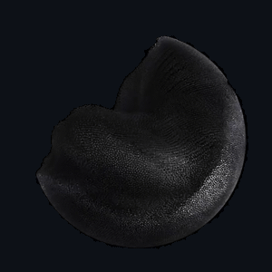

  
    
  
  
Some people study security. I build tools that practice it. Some people use AI. I build AI that uses itself. I architect systems from scratch, break them until they work, and ship things that are genuinely new. Cloud security engineer &amp; analyst. AI agent builder. That's my range, and I'm just getting started.

---

<h3>Know Me</h3>

🔭 I operate across two domains - cloud security and AI systems. Not as buzzwords. As things I've actually built and broken.

☁️ On the security side - AWS is my playground. CloudTrail, IAM, S3, CSPM, detection engineering. I know how attacks move through cloud environments because I've simulated them myself.

🤖 On the AI side - I build agents that go beyond chat. Voice, memory, screen perception, OS control, autonomous execution. Systems that actually do things.

🧠 I don't just detect threats - I trace how they move, chain by chain, tactic by tactic.

⚡ Everything I know came from building something, watching it fail, and figuring out why.

🎯 Currently: making things that don't exist yet.

 

---

  <h3>Connect</h3>
  
  &nbsp;
  
  &nbsp;
  
  &nbsp;
  
  &nbsp;
  
    
  <blockquote align="center">
    
<i>"The only truly secure system is one that is powered off, cast in a block of concrete and sealed in a lead-lined room with armed guards - and even then I have my doubts."</i> — Eugene Spafford

  </blockquote>

---

<h3>👑 Flagship Project</h3>

<b>🧠 Rika — Sovereign Personal AI</b> &nbsp;   
A sovereign AI agent built from scratch — she hears you, sees your screen, remembers everything, and controls your OS. Voice-native with sub-300ms response, 6-layer persistent memory, multi-agent swarm, and a built-in cyber operations suite. Fully local. Minimal cloud footprint. Zero restrictions.  

  <code>Sub-300ms Voice Pipeline</code> &bull; <code>6-Layer Memory</code> &bull; <code>Multi-Agent Swarm</code> &bull; <code>Local OS Control</code> &bull; <code>Screen Perception</code>

  
  
  
  
  
  
  
  

<a href="https://github.com/nssriraam/Rika"><b>Explore Flagship Repository →</b></a>

---

<h3>Tech Stack</h3>

  <h4>☁️ Cloud Security & Forensics</h4>
  

    
    
    
    
    
    
    
    
    
  

  <h4>🤖 AI Systems & Autonomous Agents</h4>
  

    
    
    
    
    
    
    
    
    
    
    
    
    
  

  <h4>⚡ Systems, Threat Intel & Tools</h4>
  

    
    
    
    
    
    
    
    
    
    
    
  

---

<h3 align="center">Projects</h3>

<table width="100%">
  <tr>
    <td width="50%" valign="top">
      <h3>🛡️ Argus — Cloud Threat Detection & Forensics</h3>
        
      
Free, open-source cloud forensics platform — an alternative to $50k/yr tools like Cado Security. Ingests AWS CloudTrail activity logs, correlates attack chains across 26+ MITRE ATT&CK rules, and generates court-admissible forensic PDF reports with chain-of-custody integrity.

      

        <code>26+ MITRE Rules</code> &bull; <code>AWS Log Ingestion</code> &bull; <code>Graph Attack Chains</code> &bull; <code>Chain-of-Custody</code>
      

      

        
        
        
        
      

      <a href="https://github.com/nssriraam/argus"><b>Explore Repository →</b></a>
    </td>
    <td width="50%" valign="top">
      <h3>⚡ Marrow — Where FinOps Meets SecOps</h3>
        
      
Autonomous command center that correlates AWS billing footprints with Security Hub findings to identify exposed, idle resources. Leverages an AMD-hosted Fireworks AI model (DeepSeek V4 Pro) to reason over structured JSON payloads, generating deterministic terminate/patch decisions with exact cost savings.

      

        <code>Fireworks AI (DeepSeek)</code> &bull; <code>AMD Instinct MI300X</code> &bull; <code>Cost + SecOps Reasoning</code>
      

      

        
        
        
        
      

      <a href="https://github.com/nssriraam/marrow"><b>Explore Repository →</b></a>
    </td>
  </tr>
  <tr>
    <td width="50%" valign="top">
      <h3>🔒 Lethe — Ephemeral Zero-Trust Cloud Sandboxes</h3>
        
      
An orchestration engine that provisions completely isolated, zero-trust cloud environments for security research. Parses Terraform/HCL to build dependency graphs, provisions via LocalStack or real AWS APIs, and tracks a TTL countdown to auto-destroy resources while writing an immutable forensic audit log.

      

        <code>IaC Graph Engine</code> &bull; <code>LocalStack Offline</code> &bull; <code>Automated TTL Teardown</code> &bull; <code>Immutable Audit</code>
      

      

        
        
        
        
        
      

      <a href="https://github.com/nssriraam/lethe"><b>Explore Repository →</b></a>
    </td>
    <td width="50%" valign="top">
      <h3>🎯 SSH Honeypot & Attack Analysis</h3>
        
      
Deployed an instrumented Cowrie SSH honeypot on AWS EC2 (EU-North-1) to capture and analyze real-world brute-force tradecraft. Recorded 16 active sessions, 16 unique attacker credentials, and mapped post-exploitation reconnaissance commands directly to MITRE ATT&CK tactics.

      

        <code>Cowrie Honeypot</code> &bull; <code>AWS EC2 (EU-North-1)</code> &bull; <code>MITRE ATT&CK Mapping</code> &bull; <code>Attack Baselines</code>
      

      

        
        
        
        
      

      <a href="https://github.com/nssriraam/SSH-Honeypot-Attack-Analysis"><b>Explore Repository →</b></a>
    </td>
  </tr>
</table>

---

<h3 align="center">Beyond the Domain</h3>

<i>Not everything I build is about security or AI. Sometimes I just build because I want to.</i>

<b>🎬 FrameCut — Your Cinema. Your Story.</b> &nbsp;   
A full-stack movie and TV discovery platform built for cinephiles. Personalized watchlists, star ratings, written reviews, director deep-dives, a mood-based recommendation engine, and hidden gems surfacing — all backed by automated TMDB API sync. Ships with JWT auth, infinite pagination, and full Docker containerization.  

  <code>Java 17 & Spring Boot</code> &bull; <code>PostgreSQL & Docker</code> &bull; <code>TMDB API Sync</code> &bull; <code>JWT Auth</code> &bull; <code>Render Live Deploy</code>

  
  
  
  

<a href="https://framecut-kmem.onrender.com/">🌐 <b>Live Website →</b></a> &nbsp;·&nbsp; <a href="https://github.com/nssriraam/framecut"><b>View on GitHub →</b></a>

---

  <h3>Stats</h3>
  &nbsp;

 

  

    💬 &nbsp;<i>"Data doesn't hide. People do. Logs catch both."</i>
  

  

